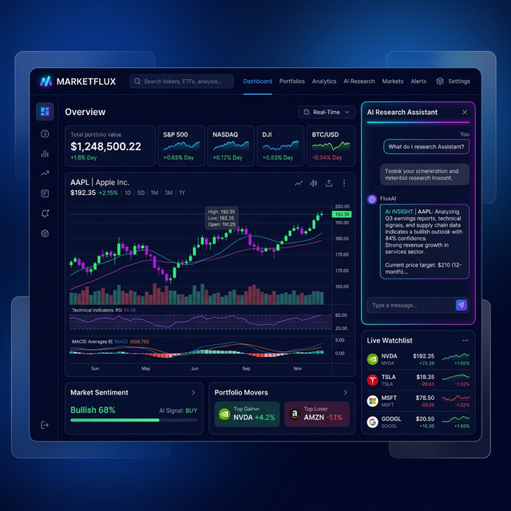
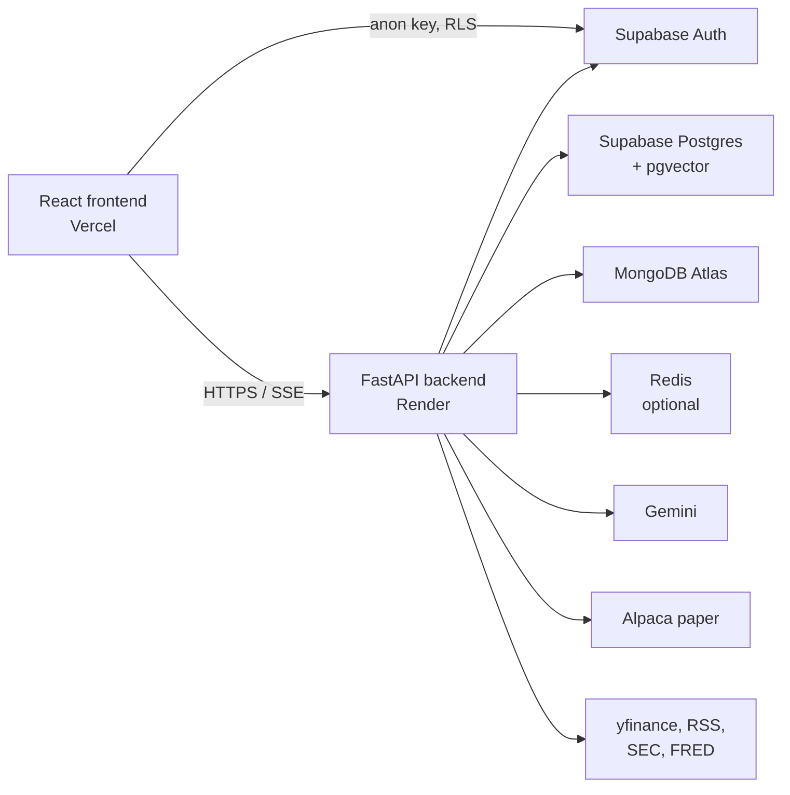

# MarketFlux

[](https://github.com/Jashwanth2343/Marketflux/actions/workflows/ci.yml)

An AI trading copilot that researches a name, sizes the risk, and stages a paper trade you approve before anything is sent.

**Live demo:** `https://your-marketflux-demo.vercel.app` (set this after the Vercel deploy)



Add a short product recording at `assets/copilot.gif` when you have one.

MarketFlux is a portfolio demo. It paper-trades. It is not investment advice.

## Architecture



Supabase is the auth and durable research store. MongoDB still holds copilot chat history, news, and a few legacy collections, so the API refuses to start without `MONGO_URL`. Redis is an optional cache.

## How the agent loop works

The copilot is a hand-rolled tool loop in `MarketFlux/backend/copilot_agent.py`. It does not use LangChain or LangGraph.

1. `POST /api/copilot/chat/stream` checks the signed-in user, the per-IP rate limit, and the daily turn cap.
2. The last few turns for that session are loaded from MongoDB.
3. The loop builds a system prompt, reads the paper account, and recalls long-term memory from Postgres when it is configured.
4. Gemini (or an OpenAI-compatible model on OpenRouter or NVIDIA NIM) is called with research tools, paper-trading tools, and risk tools.
5. Each tool result is streamed to the browser as a server-sent event.
6. With confirm-before-trade on, order tools are staged in MongoDB. Nothing reaches Alpaca until you approve the card.
7. Approval sends the order through `alpaca-py` with `paper=True`.

`run_python` is not offered to the model unless `ENABLE_CODE_SANDBOX=true`. Demo mode cannot turn that flag on.

## Safety design

- **Python tool.** `run_python` is off by default. Pandas and numpy can read files (`pd.read_csv`, `np.load`, `np.save`), so the tool is not a sandbox. `DEMO_MODE` forces it off. When a private host opts in, those I/O methods are rejected before the subprocess starts.
- **Row level security.** Tables live in `supabase/migrations/`. RLS is on. Signed-in users can reach their own rows. The anon key cannot read service-only tables such as checkpoints and market documents. The backend uses the service role, which bypasses RLS.
- **Auth fails closed.** Anonymous copilot access exists only when `MARKETFLUX_ENV` is `development` or `test`. An unset environment, including a default Render service, requires a real Supabase session.
- **Demo mode.** `DEMO_MODE=true` keeps confirm-before-trade on, refuses standing agents, does not start their scheduler, and shows a "Paper trading, not investment advice" banner. The Alpaca client is constructed with `paper=True`.
- **Limits.** Copilot chat, trade approval, and standing-agent runs are limited per IP (`COPILOT_RATE_LIMIT`, default `10/minute`) and per user per day (`COPILOT_DAILY_TURNS`).
- **Browser.** Production builds fail if `REACT_APP_BACKEND_URL` is missing. CORS allows localhost only in development. The old Emergent app-builder scripts and Google-login proxy are gone. Google sign-in, if you enable it, goes through Supabase Auth.

## Tech stack

| Layer | Choice |
| --- | --- |
| Frontend | React (CRA + CRACO), Tailwind, deployed on Vercel |
| Backend | FastAPI on Python 3.12, Docker on Render |
| Auth and research data | Supabase Auth, Postgres, pgvector |
| Copilot history and news | MongoDB |
| Cache | Redis via `REDIS_URL` (`rediss://` for TLS), optional |
| Models | Gemini through `google-genai` for chat and one-shot text. Tool-calling loops still use `google-generativeai` |
| Broker | Alpaca paper trading |
| Market data | yfinance, RSS, optional Finnhub, FRED, Alpha Vantage |

## Tests

`pytest` collects **141** tests. **112** pass without a running server. **29** integration tests skip unless `REACT_APP_BACKEND_URL` points at a live API. CI runs the full suite, Ruff, frontend ESLint, an import smoke test, and `yarn build`.

## Quick start

Python 3.12 and Node 20. From the repo root:

```bash
cd MarketFlux/backend
python3 -m venv venv
./venv/bin/pip install -r requirements.txt
cp .env.example .env
```

Set at least `MARKETFLUX_ENV=development`, `MONGO_URL`, `DB_NAME`, and `JWT_SECRET` (32 characters or more). A local MongoDB is enough for the API to boot. Supabase and Gemini unlock login and the copilot.

```bash
cd MarketFlux/backend
./venv/bin/python -m uvicorn server:app --reload --host 127.0.0.1 --port 8000
```

```bash
cd MarketFlux/frontend
cp .env.example .env.local
yarn install
BROWSER=none HOST=127.0.0.1 PORT=3000 \
  REACT_APP_BACKEND_URL=http://localhost:8000 \
  yarn start
```

Open `http://localhost:3000`.

```bash
cd MarketFlux/backend
./venv/bin/python -m pytest -q
./venv/bin/ruff check .

cd MarketFlux/frontend
CI=true REACT_APP_BACKEND_URL=http://localhost:8000 yarn lint
CI=true REACT_APP_BACKEND_URL=http://localhost:8000 yarn build
```

`yarn start` uses `craco.config.js`. The old visual-edit Babel plugin is not loaded.

## Deploy

Details and the full variable list are in [MarketFlux/DEPLOYMENT.md](MarketFlux/DEPLOYMENT.md).

- **API:** Render Blueprint `render.yaml`. It builds `MarketFlux/backend/Dockerfile`, listens on `0.0.0.0:$PORT`, and health-checks `GET /api/health`. `DEMO_MODE=true` is set for the public demo.
- **Frontend:** Vercel, using the root `vercel.json` (SPA rewrite and the same security headers as `MarketFlux/frontend/nginx.conf`). Set `REACT_APP_BACKEND_URL` to the Render URL before the build. Source maps are off.
- **Supabase:** run the SQL files in `supabase/migrations/` in order, then put the project URL and keys in Render and Vercel. Do not put the service role key in the frontend.
- **MongoDB Atlas:** M0 cluster, connection string in `MONGO_URL`, database name in `DB_NAME`.

## License

[MIT](LICENSE)
